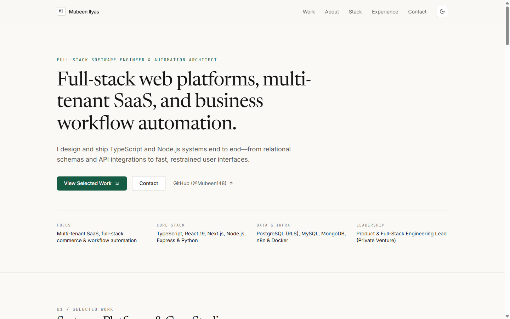
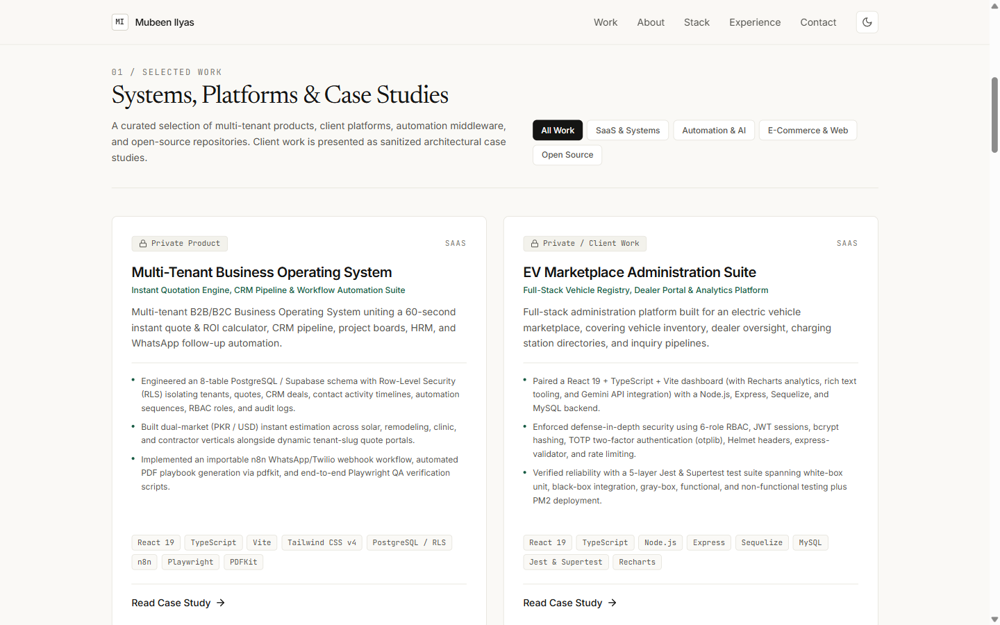
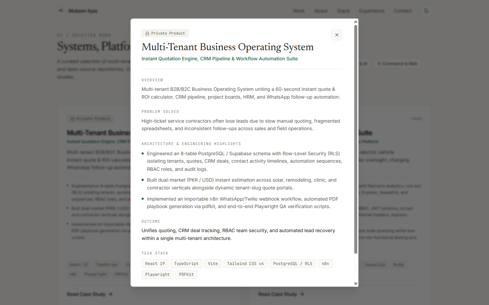
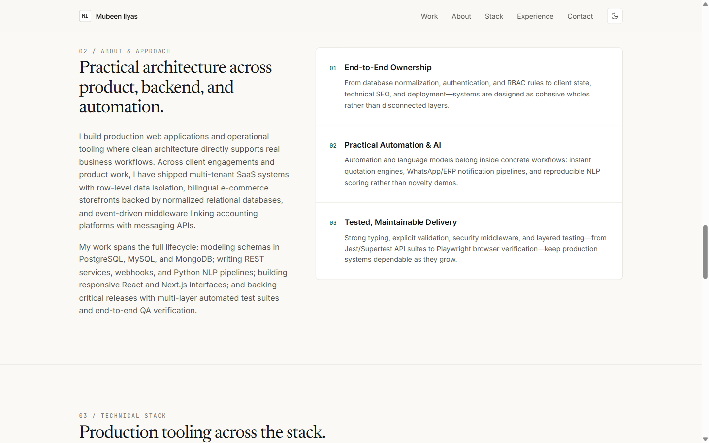
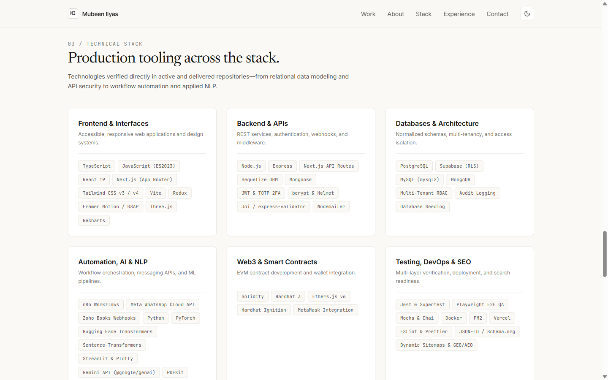
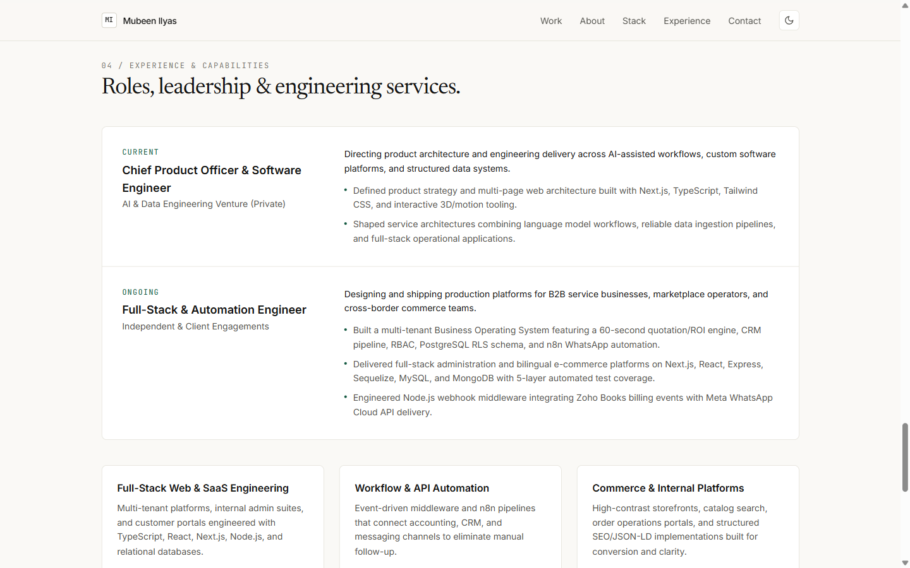
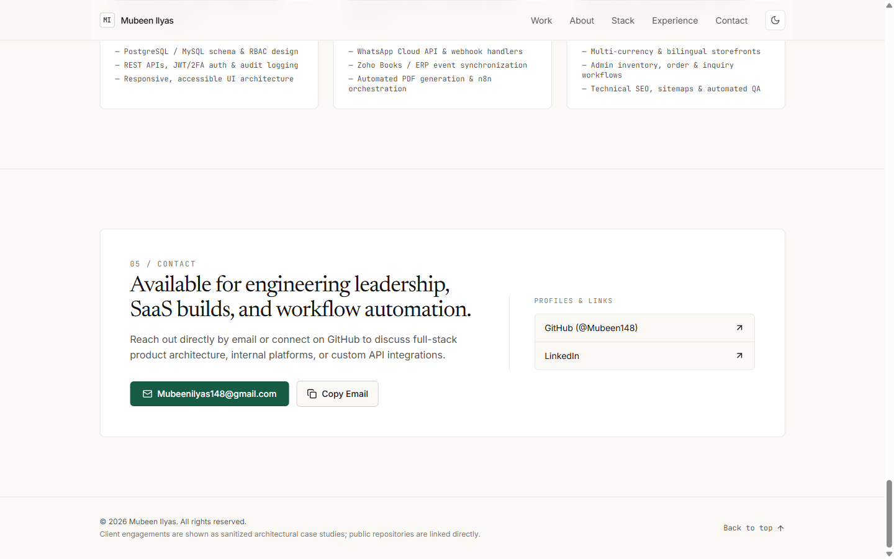
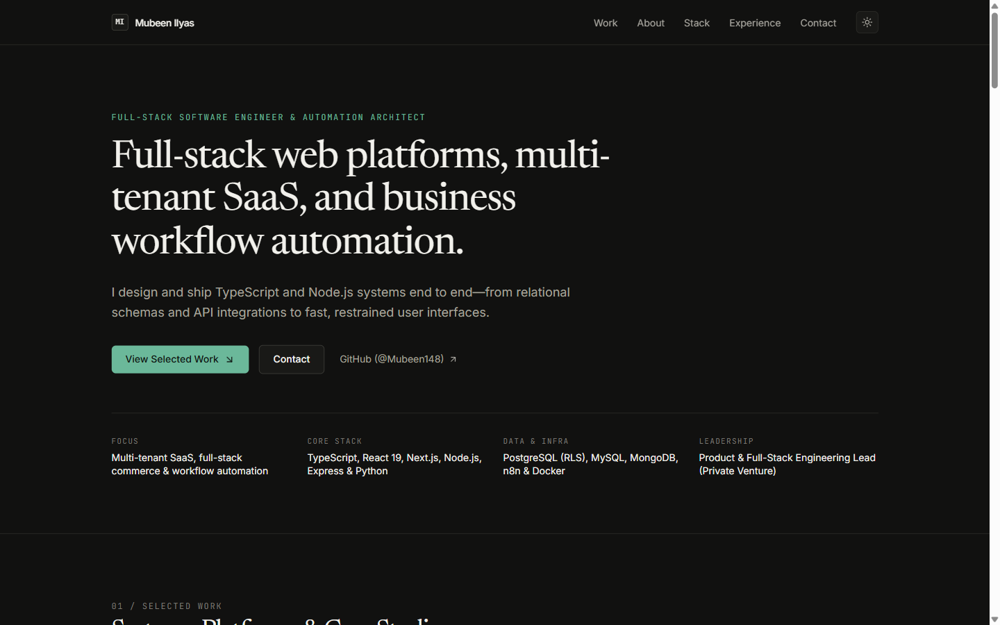
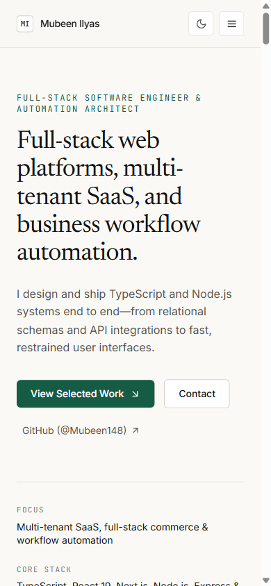
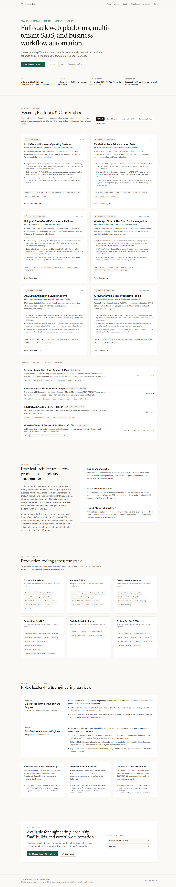

# Mubeen Ilyas — Portfolio

**Full-Stack Software Engineer & Automation Architect** building multi-tenant SaaS systems, full-stack commerce platforms, workflow automation middleware, and applied AI tooling.

- **GitHub:** [github.com/Mubeen148](https://github.com/Mubeen148)
- **LinkedIn:** [linkedin.com/in/mubeen-ilyas-b4a4601b8](https://www.linkedin.com/in/mubeen-ilyas-b4a4601b8/)
- **Email:** [Mubeenilyas148@gmail.com](mailto:Mubeenilyas148@gmail.com)

---

## Portfolio Preview (Complete Walkthrough)

Browse the entire portfolio directly below—including every section, the interactive case-study modal, dark mode, and mobile layout—without running the project locally.

### 1. Hero & Engineering Snapshot
Clear positioning, primary actions, and core focus overview in warm-paper editorial typography.



### 2. Selected Work & Featured Case Studies
Filterable project showcase combining sanitized private architecture case studies and linked open-source repositories.



### 3. Interactive Case Study Modal
Detailed breakdown of the problem solved, system architecture highlights, outcome, and full tech stack.



### 4. About & Engineering Approach
Background across full-stack product delivery paired with three core engineering principles.



### 5. Technical Stack
Production technologies grouped by domain across frontend, backend APIs, databases, automation/NLP, Web3, and QA/DevOps.



### 6. Experience & Capabilities
Leadership experience and engineering service offerings across SaaS systems, API automation, and commerce platforms.



### 7. Contact & Footer
Direct email action with one-click copy, GitHub and LinkedIn links, and privacy note.



### 8. Dark Mode Theme
Optional high-contrast dark theme persisted via `localStorage` and toggled from the header.



### 9. Mobile Responsive View (`390px`)
Clean single-column responsive layout and mobile navigation drawer.

<p align="center">
  
</p>

<details>
<summary><strong>View Complete Full-Page Desktop Screenshot</strong></summary>

<br />



</details>

---

## Tech Stack

- **Framework:** React 19 + TypeScript + Vite
- **Styling:** Tailwind CSS v4 (`@tailwindcss/vite`)
- **Icons:** Lucide React
- **Typography:** Newsreader, Inter, JetBrains Mono

## Local Development

```bash
npm install
npm run dev
```

## Verification & Production Build

```bash
npm run typecheck
npm run lint
npm run build
```

## Profile & Contact Links

Profile details, email, LinkedIn URL, and an optional `resumeUrl` are configured in `src/data/profile.ts`.

## Deployment

Configured for zero-config static deployment on **Vercel** (`vercel.json` included) or **Netlify** (`dist/` output).
